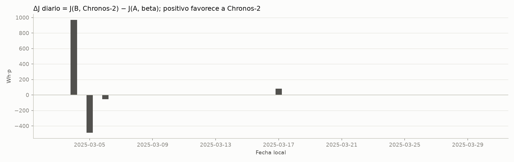

# Pronóstico solar y planificación de energía en un sistema aislado

Este proyecto evalúa si los pronósticos de **Chronos-2**, sin entrenamiento
adicional, mejoran el servicio energético frente a una referencia probabilística
**beta**. El caso es semisintético y está contextualizado en el Centro Educativo
Rural El Rayo, Támesis (Antioquia): combina irradiancia ERA5 y demanda sintética
con un sistema fotovoltaico y baterías hipotéticos.

## Cómo se hace

Se adapta el modelo de [Acuña et al. (2021)](https://doi.org/10.3390/en14102789)
y se comparan ambos pronósticos con el mismo simulador físico y controlador
predictivo heurístico (MPC). Cada método recibe 336 horas de historia, pronostica
24 horas y replanifica cada 6 horas con 50 escenarios comunes. Comparten demanda,
parámetros y estado inicial; después conservan sus propios estados de batería.
El modo original se calibró en enero y se evaluó del 3 al 30 de marzo de 2025.

El controlador ofrece el modo original y un modo sensible al riesgo mediante
CVaR, usado con cualquiera de los dos pronosticadores. El modo original es el
predeterminado. El modo CVaR permite penalizar la demanda no atendida y ponderada
por prioridad en los peores escenarios. T07 fijó α = 0,9 y seleccionó λ_R = 0
con datos de desarrollo: ese peso no aplica una penalización de riesgo.

El MPC y el caso de Támesis son adaptaciones del proyecto; no constituyen una
reproducción numérica del caso del artículo. El [protocolo](docs/IDEA.md) detalla
estas diferencias y [docs/datos.md](docs/datos.md) describe datos y unidades.

## Resultados

Evaluación T05 con el **MPC original**, en CPU sobre **28 días, 672 horas y 112
orígenes por método**:

| Indicador | Beta | Chronos-2 |
|---|---:|---:|
| MAE diurno de irradiancia (W/m²) | 66,33 | 64,20 |
| Cobertura diurna del intervalo 0,1–0,9 (nominal: 80 %) | 76,98 % | 80,95 % |
| Demanda atendida ponderada por prioridad, J (Wh·p) | 285 714,42 | 286 220,02 |
| Fracción ponderada atendida, S_pond | 93,12 % | 93,29 % |
| Energía no atendida (Wh) | 16 418,24 | 16 352,93 |
| Atención de cargas críticas | 100 % | 100 % |

Chronos-2 reduce el MAE diurno un **3,2 %**, pero la mejora en J es de solo
**0,18 %** (+505,60 Wh·p), concentrada en 4 de los 28 días. Ambas alternativas
respetaron los balances y límites físicos y las verificaciones no detectaron
uso de información futura. Un pronóstico mejor no garantiza más servicio.



El [artículo del proyecto](docs/articulo.md) presenta las tablas, figuras y
análisis de T05. Los resultados son exploratorios: usan demanda sintética,
meteorología de reanálisis y una sola realización; no prueban significancia ni
beneficios en una instalación real.

En T07, la selección con seis semanas de desarrollo y validación en las dos
semanas posteriores produjo **λ_R = 0** para ambos pronosticadores. La regla de
validación se cumple frente a CVaR con peso cero porque es el mismo caso; no
demuestra una mejora por penalización de riesgo. El modo CVaR con peso cero puede
diferir del original porque considera más calendarios candidatos. La muestra de
validación es pequeña: su cola diaria del 10 % equivale a 1,4 días.

## Ejecutar el experimento

Se necesita [uv](https://docs.astral.sh/uv/getting-started/installation/).
Desde la raíz del repositorio:

```powershell
uv sync --locked --extra pronosticos
uv run --locked --extra pronosticos energy-project --config scripts/configuracion.json
uv run --locked --extra pronosticos python -m src.experimento --salida results/evaluacion
```

`uv` prepara Python 3.12 y el entorno bloqueado. El primer comando de ejecución
valida los datos; el segundo compara los métodos y exporta tablas, CSV, figuras
y `resumen.json`. La carpeta de salida debe ser nueva. La primera inferencia
descarga los pesos públicos de Chronos-2; no requiere claves de API y funciona
en CPU. Los datos del caso ya están incluidos.

### Usar el modo sensible al riesgo

Copie `scripts/configuracion.json` en `scripts/configuracion_cvar.json` y añada
estos campos **en la raíz** de la copia, conservando los demás:

```json
"modo_mpc": "cvar",
"alpha_cvar": 0.9,
"lambda_riesgo": 1.0
```

`alpha_cvar` es opcional, por defecto 0,9, y debe estar entre 0 y 1 sin incluir
los extremos. `lambda_riesgo` es obligatorio en modo CVaR, finito y no
negativo; el valor 1 del ejemplo es **ilustrativo, no calibrado**. Con 50
escenarios, α = 0,9 considera los cinco de mayor pérdida. `lambda_terminal`
conserva su uso en el modo original y no interviene en la puntuación CVaR.

La copia debe quedar en `scripts/`: las rutas de datos se resuelven respecto
a la carpeta del JSON. Para ejecutar ambos pronosticadores con el mismo modo:

```powershell
uv run --locked --extra pronosticos python -m src.experimento --config scripts/configuracion_cvar.json --salida results/evaluacion_cvar
```

Para usar el peso calibrado, indique en `--config` el archivo
`results/t07_calibracion/configuracion_cvar.json` generado por la calibración.
Este comando usa el periodo reservado de marzo. No use esos resultados para
elegir o ajustar los parámetros: T07 seleccionó el peso con desarrollo.
`candidatos.csv` registra las métricas por calendario único y
`planes_elegidos.csv` el calendario completo seleccionado en cada origen;
`decisiones.csv` y `resumen.json` registran las decisiones y la configuración.
El [protocolo](docs/IDEA.md#62-modo-sensible-al-riesgo-t06) explica el cálculo
y sus límites.

### Calibrar el modo CVaR

**T07 completada y verificada en CPU.** El protocolo ajusta un peso común a
ambos pronosticadores con datos de desarrollo y lo valida en un periodo posterior
de desarrollo. La campaña usa marzo solo para la regresión del modo original.

Para repetir la calibración desde la raíz del repositorio, use una carpeta de
salida nueva; la campaña registrada tardó 44,1 minutos en CPU:

```powershell
uv run --locked --extra pronosticos python -m src.controlador --modo cvar --salida results/t07_calibracion
```

El informe `resumen.json` registra el criterio, los parámetros, las métricas,
la validación y las huellas de reproducibilidad. La configuración generada
`configuracion_cvar.json` queda junto al informe y mantiene rutas válidas a los
datos; la configuración original no se modifica. El archivo se genera incluso
si la validación falla: consulte en el informe si se recomienda el peso antes
de usarlo. El [protocolo de T07](docs/IDEA.md#calibración-y-validación-t07)
detalla los periodos, el criterio, los resultados y sus límites.

La regresión del modo original reprodujo las 672 horas y 112 orígenes por
pronosticador de T05 frente al controlador anterior a T06. Para repetirla:

```powershell
uv run --locked --extra pronosticos python -m scripts.verificar_regresion_t07 --salida results/t07_regresion_original
```

La regresión requiere el objeto Git `9bc279c7caa2aa81eab10567d48741e93fd10f9f`
en el historial local. Lee el controlador de esa revisión sin cambiar el
checkout. El informe generado queda en `results/t07_regresion_original/resumen.json`.

## Ejecutar las pruebas

```powershell
uv run --locked --extra pronosticos pytest -q
```

Las pruebas comprueban datos, cronología, balances, límites de baterías,
controlador y comparación pareada. Usan dobles de los modelos, sin descargar
pesos ni ejecutar el experimento completo.
Para la instalación básica: `uv run --locked pytest -q`; las pruebas con
dependencias opcionales se omiten.

## Integrantes

Thomas Serna · Juan Esteban Palacio · Jeronimo Gutierrez
