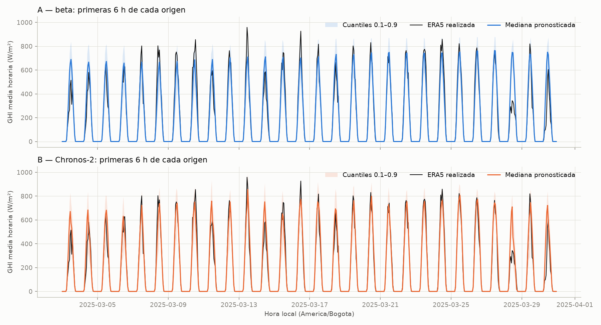
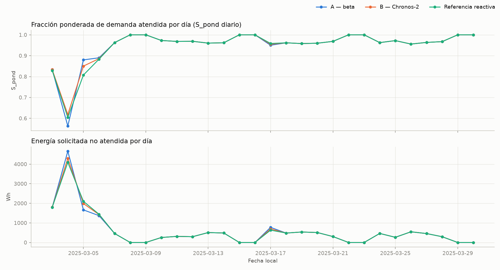
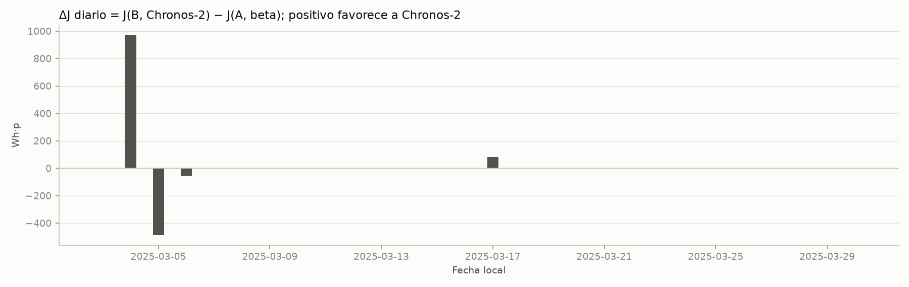
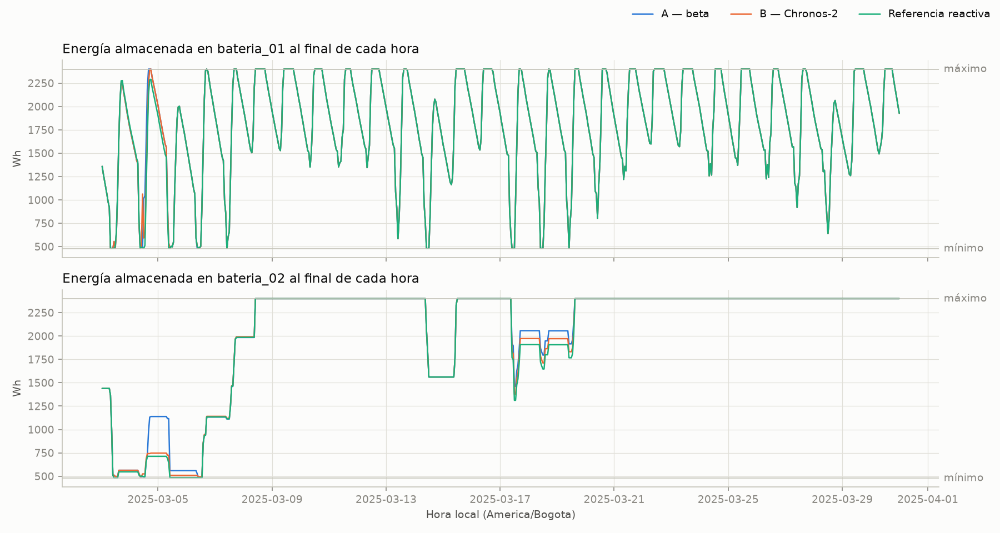

# Pronósticos de Chronos-2 frente a una referencia beta en la planificación de un sistema fotovoltaico aislado

**Borrador del artículo del curso Optimización 1 (T05).**
Caso semisintético contextualizado en el Centro Educativo Rural El Rayo, Támesis
(Antioquia). Integrantes: Thomas Serna, Juan Esteban Palacio y Jeronimo Gutierrez.

> Estado: borrador. Las secciones 3 a 6 se generaron a partir de
> `results/t05_evaluacion_verificada/` (regenerable con el comando de la sección 3.6);
> sus cuatro figuras se copiaron a `docs/figuras/`. El resumen,
> la introducción y la revisión de literatura se redactaron a partir de `docs/IDEA.md`,
> de Acuña et al. (2021) y de la ficha de Chronos-2; el equipo debe revisarlos antes de
> la entrega.

## Resumen

En las zonas no interconectadas hay que decidir qué cargas atender con una irradiancia
incierta. Este trabajo adapta el modelo de planificación operativa de Acuña et al.
(2021) a un sistema fotovoltaico aislado hipotético, contextualizado en una escuela
rural de Támesis (Antioquia), y evalúa si sustituir una referencia probabilística beta
por los pronósticos *zero-shot* del modelo fundacional Chronos-2 mejora la atención de
cargas. Ambas alternativas comparten física, demanda sintética, escenarios con números
aleatorios comunes y un control predictivo heurístico que replanifica cada 6 h con un
horizonte de 24 h. En la evaluación reservada, del 3 al 30 de marzo de 2025, Chronos-2
redujo el MAE diurno de la irradiancia en un 3,2 % (9,3 % en las seis horas ejecutadas)
y acercó la cobertura del intervalo 0,1–0,9 a la nominal (80,95 % frente a 76,98 %).
La demanda ponderada atendida, en cambio, solo aumentó un 0,18 % (+0,16 p.p. de
S_pond), con diferencias concentradas en 4 de los 28 días. Las cargas críticas se
atendieron por completo con ambos pronósticos y no hubo violaciones físicas ni
filtraciones de información futura. Estos resultados exploratorios indican que el
diseño del controlador determina cuánto de la mejora predictiva llega al servicio.

**Palabras clave:** zonas no interconectadas; energía solar; pronóstico probabilístico;
modelos fundacionales; control predictivo; simulación-optimización.

## 1. Introducción

El acceso universal a servicios de energía asequibles, fiables y modernos para 2030 es
la meta 7.1 de los Objetivos de Desarrollo Sostenible (Naciones Unidas, s. f.). En
Colombia, una parte de la población rural sigue sin electricidad, y en las escuelas
rurales esa carencia pone en riesgo el acceso a la educación y a otros servicios básicos
(Acuña et al., 2021). Los sistemas fotovoltaicos con baterías son una alternativa para
estas zonas no interconectadas, pero dependen de un recurso variable que no se puede
controlar. Con una capacidad limitada, operar bien el sistema significa decidir, hora a
hora, qué cargas atender y cuándo usar o reponer la energía almacenada.

Acuña et al. (2021) formularon esta planificación operativa para Volcanes, una escuela
rural de Caparrapí (Cundinamarca), como un problema integrado de despacho y selección de
cargas (*unit commitment*). El objetivo es maximizar la demanda atendida ponderada por
prioridad. Como el modelo exacto no encontró soluciones enteras en horizontes de una
semana, propusieron una heurística rápida y la integraron en un esquema de
simulación-optimización. La irradiancia se modela como una variable aleatoria beta, la
heurística resuelve cada réplica y se elige la solución determinista más frecuente. En
sus experimentos, la solución estocástica alcanza mejores niveles de servicio que la
determinista, que puede sobrestimar la capacidad del sistema. Los autores mencionan el
control predictivo como una aplicación futura del método.

En paralelo, los modelos fundacionales para series de tiempo ofrecen otra forma de
obtener pronósticos. Modelos preentrenados con grandes colecciones de series, como
Chronos, TimesFM y Moirai, pronostican series nuevas sin entrenamiento específico
(*zero-shot*) (Ansari et al., 2024; Das et al., 2024; Woo et al., 2024). Chronos-2
extiende este enfoque a problemas multivariados y con covariables, entrega cuantiles
para varios pasos y puede ejecutarse en CPU (Ansari et al., 2025; Amazon, s. f.). En un
sistema aislado, esto permite sustituir una distribución ajustada por hora del día por
un pronóstico condicionado a la secuencia reciente de observaciones, sin entrenar un
modelo propio. Sin embargo, la calidad de un pronóstico y su valor para una decisión son
propiedades distintas (Murphy, 1993). Un error menor no garantiza mejores decisiones
cuando el pronóstico alimenta un problema de optimización (Elmachtoub y Grigas, 2022).

Este trabajo pregunta si la información predictiva de Chronos-2 mejora la atención de
cargas de un sistema fotovoltaico aislado frente a una referencia probabilística beta,
cuando la física, la demanda, el estado inicial y la estrategia de decisión son los
mismos. Para responderlo se construye un caso semisintético: un sistema hipotético para
el Centro Educativo Rural El Rayo, en Támesis (Antioquia), con irradiancia del
reanálisis ERA5 (Hersbach et al., 2020) y demanda sintética. No se trata de una
instalación real ni de un diagnóstico energético de la institución.

Las contribuciones son tres:

1. Una adaptación verificable del modelo de Acuña et al. (2021), con baterías
   individuales, una interpretación física explícita de las desigualdades impresas y la
   misma lógica de selección de cargas por prioridad.
2. Un control predictivo heurístico común. Su generador de escenarios compartido cumple
   el papel de los números aleatorios comunes, de modo que las dos alternativas solo
   difieren en el modelo que pronostica la irradiancia.
3. Una evaluación pareada y reproducible de la calidad del pronóstico y del servicio
   energético, con comprobaciones de balances, de filtraciones de información futura y
   de repetición.

El objetivo no es reproducir numéricamente el caso Volcanes ni demostrar que Chronos-2
es superior. El trabajo cumple su propósito si explica, con resultados verificables, si
Chronos-2 aporta o no una mejora bajo estos supuestos. La sección 2 revisa la
literatura; la 3 describe el método; la 4 presenta los resultados; la 5 los discute, y
la 6 resume las conclusiones.

## 2. Revisión de literatura

### 2.1. Planificación operativa de sistemas aislados bajo incertidumbre

El problema de Acuña et al. (2021) pertenece a una línea de trabajos que combinan
simulación y optimización para operar sistemas renovables con almacenamiento. Mallor et
al. (2015) gestionan la operación de estos sistemas con una metodología de simulación
basada en optimización. Azcárate et al. (2017) incorporan un pronóstico probabilístico
del recurso en la gestión táctica y operativa de un sistema eólico con almacenamiento.
Figueira y Almada-Lobo (2014) proponen una taxonomía de estos métodos híbridos; en ella,
el esquema de Acuña et al. corresponde a la simulación con iteraciones basadas en
optimización. Juan et al. (2015) revisan las simheurísticas, que integran la simulación
en heurísticas y metaheurísticas para problemas combinatorios estocásticos.

En los sistemas aislados, el costo computacional es una restricción práctica. Micangeli
et al. (2020) diseñan minirredes aisladas con estrategias de operación predictivas de
bajo requerimiento computacional. Acuña et al. (2021) justifican su heurística por los
recursos de cómputo limitados de una escuela rural.

### 2.2. Modelos probabilísticos de la irradiancia

La distribución beta es una representación habitual de la irradiancia en estudios de
sistemas eléctricos con generación solar (Karaki et al., 1999; Atwa et al., 2010). Su
soporte acotado y la variedad de formas que admite permiten representar una variable no
negativa y asimétrica. Atwa et al. (2010) modelan la irradiancia de cada hora con una
beta, y Acuña et al. (2021) ajustan una beta de cuatro parámetros a 39 semanas de datos
de Volcanes, que validan con una prueba de Kolmogórov-Smirnov. Una beta por hora
describe la distribución de cada hora del día. Por sí sola, sin embargo, no representa
la dependencia entre horas consecutivas, que determina si un periodo nublado agota las
baterías.

El pronóstico probabilístico de la generación fotovoltaica se ha consolidado como campo
propio. Van der Meer et al. (2018) revisan sus métodos, las formas de expresar la
incertidumbre y su evaluación. La competencia GEFCom2014, que incluyó una categoría
solar, evaluó los cuantiles con la pérdida *pinball* (Hong et al., 2016). Esa pérdida
proviene de la regresión cuantílica (Koenker y Bassett, 1978) y es una regla de
puntuación propia: su valor esperado es mínimo cuando se informan los cuantiles
verdaderos (Gneiting y Raftery, 2007). Este trabajo la complementa con MAE, RMSE y
cobertura, que miden por separado el error de la mediana y la calibración del intervalo.

### 2.3. Escenarios y control predictivo

Un controlador que anticipa necesita trayectorias completas, no solo distribuciones
marginales por hora. Pinson et al. (2009) generan escenarios de producción eólica a
partir de pronósticos probabilísticos marginales y modelan la dependencia entre
anticipaciones con una cópula gaussiana. En hidrometeorología, el *Schaake shuffle*
reordena los miembros de un conjunto según los rangos de observaciones históricas para
recuperar su dependencia espacio-temporal (Clark et al., 2004). El generador común de
este trabajo sigue la segunda idea: remuestrea bloques históricos de 24 h, toma sus
rangos en cada hora del horizonte y los transforma en cuantiles de cada proveedor.

El control predictivo con horizonte deslizante resuelve en cada instante de decisión un
problema sobre un horizonte, aplica las primeras decisiones y vuelve a planificar desde
el estado alcanzado. Parisio et al. (2014) lo aplican a la operación de una microrred
mediante programación lineal entera mixta. Este trabajo adopta una versión heurística:
en lugar de resolver un problema entero, compara calendarios candidatos generados con
la heurística de Acuña et al. (2021) y los evalúa sobre los escenarios.

### 2.4. Modelos fundacionales para series de tiempo

Chronos convierte cada serie en una secuencia de símbolos mediante escalamiento y
cuantización, y entrena con ellos arquitecturas de lenguaje T5 con pérdida de entropía
cruzada. Tras preentrenarse con datos públicos y series sintéticas, pronostica series no
vistas sin entrenamiento adicional (Ansari et al., 2024). TimesFM usa un transformador
de solo decodificador sobre parches de la serie (Das et al., 2024). Moirai es un
transformador con codificador enmascarado, entrenado con un archivo abierto de series de
nueve dominios (Woo et al., 2024).

Chronos-2 es un modelo de solo codificador, con unos 120 millones de parámetros. Su
mecanismo de atención por grupos le permite aprender en contexto de series relacionadas
y de covariables. Emite cuantiles para varios pasos, y sus autores informan resultados
de vanguardia en las evaluaciones fev-bench, GIFT-Eval y Chronos Benchmark II (Ansari et
al., 2025; Amazon, s. f.). Estas evaluaciones miden el error de pronóstico sobre muchas
series, no el efecto del pronóstico en una decisión operativa. Además, como el
preentrenamiento combina colecciones públicas y series sintéticas, no puede descartarse
que el modelo haya visto series semejantes a las de evaluación. Este trabajo usa
Chronos-2 en su forma más simple: univariado, sin covariables y con el checkpoint
oficial sin ajuste.

### 2.5. Calidad del pronóstico y valor para la decisión

Murphy (1993) distingue tres sentidos en que un pronóstico es bueno: consistencia con el
juicio de quien pronostica, calidad frente a lo observado y valor para quien decide. La
calidad no implica valor, porque el beneficio depende del problema de decisión y de cómo
se usa el pronóstico. La analítica prescriptiva formaliza esta idea. Bertsimas y Kallus
(2020) prescriben decisiones directamente a partir de datos auxiliares, adaptando
métodos de aprendizaje automático a la optimización condicionada. Elmachtoub y Grigas
(2022) proponen entrenar los modelos con la pérdida que induce la decisión en lugar del
error de predicción. En la planificación de un sistema aislado, esto significa que una
mejora en MAE o *pinball* debe juzgarse por su efecto en la demanda atendida.

### 2.6. Brecha y posición de este trabajo

Los trabajos revisados abordan piezas de este problema: el modelado de la irradiancia,
el pronóstico probabilístico, la generación de escenarios y el control. Las
evaluaciones de los modelos fundacionales miden sobre todo precisión. Los métodos de
simulación-optimización para sistemas aislados se han apoyado en distribuciones
ajustadas a la historia. La búsqueda realizada para este borrador no fue sistemática y
no identificó estudios revisados por pares que integren un modelo fundacional
*zero-shot* en la operación de un sistema fotovoltaico aislado con prioridades de carga.
Este trabajo aborda esa combinación con un diseño pareado: mismo sistema, mismos
escenarios y mismo controlador, de modo que las diferencias de servicio puedan
atribuirse al pronóstico.

## 3. Método

### 3.1. Pregunta y diseño

Bajo la misma física, demanda, estado inicial y estrategia de decisión, ¿mejora la
información predictiva de Chronos-2 la atención de cargas de un sistema fotovoltaico
aislado frente a una referencia probabilística de irradiancia basada en distribuciones
beta? El experimento es **pareado**: las dos alternativas difieren únicamente en el
modelo que pronostica la irradiancia; comparten datos, sistema, generador de escenarios,
controlador, simulador, métricas y la meteorología realizada que las evalúa.

| Alternativa | Pronóstico de irradiancia | Resto del experimento |
|---|---|---|
| A — beta | Mezcla, por hora local, de masa en cero y beta de dos parámetros (loc = 0, escala = 1,05 × máximo positivo) ajustada por máxima verosimilitud sobre las últimas 336 h | Idéntico |
| B — Chronos-2 | Cuantiles 0,1–0,9 del checkpoint oficial `amazon/chronos-2` (revisión `29ec376…`), sin entrenamiento, con las mismas 336 h | Idéntico |

### 3.2. Datos

- **Irradiancia:** GHI media horaria de reanálisis ERA5 (Open-Meteo) para las
  coordenadas de la escuela, 2024–2025 (17 544 h). Se usa como referencia
  meteorológica y no como medición local. Una hora se considera disponible al cerrar su
  intervalo (idealización).
- **Demanda:** 13 cargas con potencias, prioridades (1–3) y ventanas de uso supuestas.
  Generan 84 días (2016 h) de demanda programada sintética (semilla 20261018),
  conciliada con cuatro diferencias provisionales del medidor. La demanda se supone
  conocida por ambas alternativas para aislar la incertidumbre solar.
- **Partición temporal:** desarrollo del 6 de enero al 2 de marzo de 2025. La
  calibración usa solo la semana del 6 al 12 de enero. La evaluación reservada va del
  3 al 30 de marzo de 2025 (672 h). Ningún parámetro se ajustó con fechas de evaluación.

### 3.3. Modelo físico (adaptado de Acuña et al., 2021, §2.2)

Con paso Δt = 1 h y energías en Wh, la generación es
E_t^FV = min(P_inv,max, P_STC · G_t/1000 · f) · Δt, con P_STC = 2000 W, f = 0,85 y
P_inv,max = 2000 W, bajo el supuesto de plano horizontal equivalente. Cada carga k
tiene solicitud r_{k,t}, compromiso x_{k,t} y servicio z_{k,t} binarios, con
0 ≤ z ≤ x ≤ r. Además, se cumple Σ_k P_k z_{k,t} ≤ min(P_inv,max, P_bus,max)
= 2000 W.

El balance del bus y la continuidad de cada batería b son:

Σ_k D_{k,t} z_{k,t} + Σ_b c_{b,t} + v_t = E_t^FV + Σ_b d_{b,t},
C_{b,t+1} = C_{b,t} + η_c c_{b,t} − d_{b,t}/η_d.

Las cotas son individuales. La carga y la descarga se limitan con el estado previo, sin
operar a la vez. Las dos baterías tienen 480–2400 Wh, 600 W y η = 0,95. Se carga solo
con excedente FV y se descarga solo para cubrir déficit. La función objetivo del
artículo, ec. (10), se evalúa sobre el servicio **realizado**:

J = Σ_{t,k} p_{k,t} D_{k,t} z_{k,t},  S_pond = J / Σ_{t,k} p_{k,t} D_{k,t}.

Las desigualdades impresas (1)–(4) y (9) del artículo se interpretan físicamente
(IDEA §4.5). Por ejemplo, la descarga se limita con el estado anterior y la (9) usa el
indicador de solicitud. La selección de cargas sigue los algoritmos 1–2 en una sola
pasada: orden por prioridad, energía e identificador, servicio completo si cabe en
energía y potencia, y un único despacho por identificador de batería.

### 3.4. Escenarios y control predictivo común

En cada origen (cada R = 6 h), cada proveedor emite cuantiles para H = 24 h, que
reciben la misma corrección: reordenamiento, no negatividad y cero en intervalos
completamente nocturnos según Astral, sin techo de irradiancia. Un generador **común**
construye N = 50 trayectorias. Remuestrea con reemplazo bloques históricos de 24 h
alineados con la hora local del origen. Transforma sus rangos por columna en
U = (r − 0,5)/M e interpola los cuantiles corregidos de cada proveedor. La semilla
depende solo del origen, de modo que A y B reciben los mismos bloques y rangos: es el
análogo de los números aleatorios comunes que usa el artículo (§3.1) para reducir la
varianza de la comparación.

El controlador propone cuatro calendarios con la heurística sobre la mediana,
protegiendo una reserva ρ ∈ {0; 0,25; 0,5; 0,75} de la capacidad útil de cada batería
frente a cargas no críticas (p < 3). Simula cada calendario fijo en los 50 escenarios
y elige, antes de ver la realización, el de mayor beneficio esperado más
λ_T · energía útil terminal. Los empates se resuelven por la menor reserva; λ_T = 0
quedó fijado en desarrollo. Ejecuta los primeros R compromisos contra la irradiancia
reservada y vuelve a planificar desde el estado realmente alcanzado. Con calendario
fijo, una carga no comprometida no se enciende aunque sobre energía (z ≤ x). Este MPC
es una adaptación del proyecto: el artículo selecciona la solución determinista más
frecuente entre réplicas y menciona el control predictivo como extensión (§§3.1 y 6).

**Referencia reactiva.** Para interpretar los resultados se añade la heurística de
T03 ejecutada hora a hora con la irradiancia realizada, sin compromisos. Equivale a
conocer de antemano la energía FV de la hora en curso, de modo que es una referencia
con información perfecta de la hora y no una alternativa admisible. No interviene en
la diferencia principal B − A.

### 3.5. Indicadores

| Tipo | Indicador | Definición |
|---|---|---|
| Pronóstico | MAE, RMSE | Error de la mediana corregida frente a ERA5, sobre todos los pares (origen, anticipación); los horizontes solapados cuentan por separado. Se informan los subconjuntos global, diurno (excluye intervalos completamente nocturnos) y diurno con anticipación ≤ R |
| Pronóstico | Pinball medio | Media sobre pares y niveles q de max(q(y − ŷ_q), (q − 1)(y − ŷ_q)) |
| Pronóstico | Cobertura | Fracción de valores realizados dentro de [q0,1; q0,9] (nominal 80 %) |
| Servicio | S_pond, J | Ec. (10) realizada |
| Servicio | Energía no atendida | Wh y fracción de la energía solicitada |
| Servicio | Servicio crítico | Fracción atendida de la energía con prioridad ≥ 3 |
| Servicio | Nivel de servicio y faltante | Análogos de §4.2 del artículo: proporción de horas con demanda atendida por completo, y fracción media no atendida en las horas con déficit. El artículo los mide sobre réplicas simuladas; aquí se miden sobre horas realizadas |
| Control | Baterías | Estados mínimo, medio y final, y horas en el mínimo |
| Consistencia | Violaciones y filtraciones | Balances y cotas con tolerancia de 1e−6 Wh; contexto, bloques y realizaciones nunca posteriores al origen |
| Recursos | Tiempos | Carga de Chronos-2, inferencia por origen y ejecución |

La comparación principal es la diferencia **pareada B − A** de J y S_pond, total y por
día local. Con 28 días, una sola realización meteorológica y demanda sintética, se
describe su distribución (media, mediana, extremos, días a favor y en contra) sin
pruebas de significancia.

### 3.6. Verificación y reproducibilidad

El comando

```
uv run --locked --extra pronosticos python -m src.experimento --salida results/t05_evaluacion
```

ejecuta A, B y la referencia con el entorno fijado en `uv.lock`. Verifica:

- los balances y las cotas de cada trayectoria;
- que A y B reciban por origen el mismo contexto (hash), los mismos bloques, rangos y
  semilla, y que ningún dato sea posterior al origen;
- la repetición de las primeras 48 h de cada rama, exigiendo las mismas decisiones,
  flujos dentro de 1e−6 Wh y cuantiles crudos dentro de rtol = 1e−5;
- que entradas y código no cambien durante la ejecución.

Si alguna comprobación falla, no publica `resumen.json`.

## 4. Resultados

Los valores proceden de la ejecución verificada el 19 de octubre de 2026
(`results/t05_evaluacion_verificada/`). Esa carpeta está excluida de Git y se
regenera con el comando anterior en una carpeta nueva; las figuras de esta sección son
copias de las suyas, guardadas en `docs/figuras/`. Entorno: Python 3.12.15,
chronos-forecasting 2.3.2, torch 2.14.1, SciPy 1.18.1 y CPU con Windows 11.

### 4.1. Consistencia del experimento

- **Física.** Las tres trayectorias cumplen balances y cotas sin violaciones. El
  error máximo es de 1,2·10⁻¹³ Wh en el bus y de 2,9·10⁻¹³ Wh en batería, frente a
  la tolerancia de 10⁻⁶ Wh.
- **Pareo y filtraciones.** En los 112 orígenes por rama, A y B recibieron el mismo
  contexto, los mismos bloques, rangos y semilla. Ningún dato fue posterior al
  origen.
- **Repetición.** Las primeras 30 h, con horizonte completo, coincidieron
  exactamente: diferencia de 0 Wh en flujos y 0 W/m² en cuantiles crudos. Una
  segunda ejecución completa produjo los mismos CSV de resultados, byte a byte; solo
  cambian los tiempos medidos de la tabla A/B.
- **Tiempos.** La ejecución duró 266 s en CPU. Cada rama tardó unos 117 s, dominados
  por las 50 simulaciones de cada calendario candidato. La inferencia media por
  origen fue de 0,010 s con beta y 0,028 s con Chronos-2, y la carga de Chronos-2
  tardó 8,4 s con los pesos en caché.

### 4.2. Calidad del pronóstico

**Tabla 1.** Error de la mediana y de los cuantiles corregidos frente a ERA5
(W/m²; 1438 pares diurnos y 2652 pares en total).

| Indicador | A — beta | B — Chronos-2 | B − A |
|---|---:|---:|---:|
| MAE diurno | 66,33 | 64,20 | −2,13 (−3,2 %) |
| RMSE diurno | 101,17 | 98,92 | −2,25 |
| Pinball diurno | 25,94 | 25,13 | −0,81 |
| Cobertura 0,1–0,9 diurna (nominal 80 %) | 76,98 % | 80,95 % | +3,96 p.p. |
| MAE diurno, primeras 6 h | 66,97 | 60,77 | −6,21 (−9,3 %) |
| MAE global | 35,97 | 34,81 | −1,15 |
| RMSE global | 74,50 | 72,84 | −1,66 |

Chronos-2 mejora todas las métricas. La mejora es mayor en las primeras seis horas
de cada origen, que son las que se ejecutan. Su intervalo central queda cerca de la
cobertura nominal; el de beta resulta algo estrecho. Durante el día, la corrección
común apenas modifica los cuantiles: el pinball diurno crudo de Chronos-2 es
25,128 W/m².



*Figura 1. ERA5 realizada frente a la mediana y la banda 0,1–0,9 de cada proveedor,
en las seis primeras horas de cada origen.*

### 4.3. Servicio energético

**Tabla 2.** Servicio realizado del 3 al 30 de marzo de 2025. La energía solicitada
es de 148 427 Wh.

| Indicador | A — beta | B — Chronos-2 | B − A | Referencia reactiva |
|---|---:|---:|---:|---:|
| J (Wh·p) | 285 714,42 | 286 220,02 | +505,60 (+0,18 %) | 285 240,84 |
| S_pond | 93,12 % | 93,29 % | +0,16 p.p. | 92,97 % |
| Energía no atendida | 16 418 Wh (11,06 %) | 16 353 Wh (11,02 %) | −65 Wh | 16 219 Wh (10,93 %) |
| Servicio crítico (p = 3) | 100 % | 100 % | 0 | 100 % |
| Servicio p = 2 | 91,79 % | 92,56 % | +0,77 p.p. | 90,61 % |
| Servicio p = 1 | 71,18 % | 70,25 % | −0,92 p.p. | 73,32 % |
| Horas con demanda atendida por completo | 93,01 % | 93,01 % | 0 | 93,01 % |
| Faltante medio en horas con déficit | 25,90 % | 25,89 % | −0,01 p.p. | 25,82 % |
| Compromisos incumplidos (carga·h) | 29 | 35 | +6 | 0 |
| Solicitudes no comprometidas (carga·h) | 191 | 194 | +3 | 209 |
| Solicitudes desatendidas (carga·h) | 220 | 229 | +9 | 209 |

En la referencia reactiva el compromiso coincide con el servicio (x = z), así que sus
solicitudes no comprometidas son exactamente las desatendidas.

La diferencia pareada favorece a Chronos-2 en J y S_pond, pero es pequeña. Se
concentra en 4 de los 28 días; los otros 24 dan exactamente el mismo J:

| Día | ΔJ = J_B − J_A (Wh·p) |
|---|---:|
| 4 de marzo | +969,44 |
| 5 de marzo | −488,86 |
| 6 de marzo | −54,98 |
| 17 de marzo | +80,00 |

La media diaria es +18,06 Wh·p y la mediana, 0. Los días que difieren corresponden
al periodo nublado del 3 al 6 de marzo, cuando el sistema queda limitado por la
energía (Figura 2), y a un día aislado. La ventaja de Chronos-2 no consiste en
atender más cargas: atiende 9 solicitudes menos. Lo que cambia es su composición:
más energía de prioridad 2 y menos de prioridad 1.



*Figura 2. S_pond diario y energía no atendida por día para A, B y la referencia.*



*Figura 3. ΔJ diario; los valores positivos favorecen a Chronos-2.*

### 4.4. Baterías y decisiones

- **bateria_01.** Alcanza su mínimo físico (480 Wh) en las tres políticas: 19 h con
  beta, 18 h con Chronos-2 y 19 h con la referencia.
- **bateria_02.** Se mantiene por encima del mínimo, con valores mínimos de 487,6,
  495,2 y 481,1 Wh.
- **Estado final.** Coincide en las tres políticas (1927,6 y 2400 Wh), porque los
  últimos días tienen excedente solar.
- **Reservas.** El controlador eligió ρ = 0 en los 112 orígenes de beta y en 110 de
  Chronos-2. Chronos-2 eligió ρ = 0,25 en dos orígenes nublados (3 de marzo a las
  18:00 y 4 de marzo a las 00:00, hora local).



*Figura 4. Energía almacenada en cada batería al final de cada hora.*

## 5. Discusión

**Un mejor pronóstico no implica, por sí solo, más servicio.** Chronos-2 reduce el
error de irradiancia en todas las métricas. Sin embargo, la mejora del servicio se
limita a +0,18 % de J y aparece solo cuando la energía escasea. En 24 de 28 días,
ambas ramas toman exactamente las mismas decisiones, porque el excedente solar
permite atender todo lo factible con cualquier pronóstico razonable. Este resultado
coincide con la advertencia de la hipótesis (IDEA §1): un error predictivo menor no
garantiza mejores decisiones.

**El controlador media el efecto del pronóstico.** Con calendario fijo (z ≤ x), una
mediana pesimista deja cargas sin comprometer, que no se encienden aunque luego
sobre energía. Una mediana optimista compromete cargas que después se desconectan
(35 compromisos incumplidos con Chronos-2 y 29 con beta). La reserva casi nunca se
activa (ρ = 0 en 222 de 224 decisiones) y el peso terminal calibrado es λ_T = 0.
Por eso el controlador usa sobre todo la mediana, y la mejor calibración de los
cuantiles de Chronos-2 tiene pocas vías para influir en la decisión. Para
aprovechar la distribución completa harían falta candidatos construidos con otros
cuantiles o una puntuación sensible a las colas. Sería una extensión, no parte de
este experimento.

**La referencia reactiva no acota al MPC.** Con información perfecta de la hora en
curso, la heurística reactiva deja menos energía sin atender (10,93 %). Aun así,
obtiene menor J que ambas ramas en la evaluación: atiende más cargas de prioridad 1
temprano y deja menos energía para las de prioridad 2. Los compromisos del MPC
actúan como una reserva implícita. En la semana de calibración ocurrió lo contrario:
la referencia obtuvo J = 73 864, frente a 73 192 (beta) y 73 784 (Chronos-2). La
miopía de la heurística y la rigidez del calendario fijo pesan de forma distinta
según la secuencia meteorológica.

**Relación con Acuña et al. (2021).** El artículo compara soluciones deterministas
y estocásticas con dos indicadores: nivel de servicio y faltante. Para Volcanes
informa un nivel de servicio del 97,44 % ± 4,96 % de las réplicas en una semana.
Aquí sus análogos sobre horas realizadas son prácticamente iguales en las tres
políticas: 93,01 % de horas atendidas por completo y alrededor de 25,9 % de faltante
medio en las horas con déficit. Las horas con déficit las determina sobre todo la
energía disponible, no el pronóstico. Las cifras no son comparables numéricamente,
porque el sistema, la demanda, la meteorología y la base de cálculo (horas frente a
réplicas) difieren. La comparación A/B conserva una idea central del artículo:
evaluar alternativas con números aleatorios comunes (aquí, bloques y rangos
compartidos) y bajo la misma realización meteorológica.

**Limitaciones.**

- La demanda es sintética y se supone conocida.
- ERA5 es un reanálisis y su disponibilidad al cierre de cada hora es una
  idealización.
- La evaluación cubre 28 días de marzo de 2025 con una sola realización
  meteorológica.
- La beta se parametriza con dos formas y escala aprendida, en lugar de la beta4 del
  artículo.
- Chronos-2 se usa sin ajuste. No puede descartarse que haya visto datos semejantes
  durante su preentrenamiento.
- La física es horaria, con plano horizontal equivalente y parámetros sin calibrar.
- El controlador es heurístico y no garantiza optimalidad.

Por todo ello, los resultados son exploratorios. No se aplicaron pruebas de
significancia ni se afirman beneficios en campo.

## 6. Conclusiones

1. Se ejecutó de extremo a extremo una comparación pareada y reproducible entre una
   referencia beta y Chronos-2 sin ajuste. Las dos ramas comparten física,
   escenarios, controlador y métricas, y el experimento registró cero violaciones
   físicas, cero filtraciones de información futura y repeticiones exactas.
2. Chronos-2 produjo mejores pronósticos de irradiancia que la referencia beta: MAE
   diurno 3,2 % menor, 9,3 % menor en las seis horas ejecutadas, menor pinball y una
   cobertura del intervalo 0,1–0,9 cercana a la nominal.
3. El beneficio sobre el servicio fue pequeño: +505,6 Wh·p de J (+0,18 %) y
   +0,16 p.p. de S_pond. Se concentró en los pocos días con escasez de energía. Las
   cargas críticas se atendieron al 100 % con ambos pronósticos.
4. La traducción de la calidad predictiva en servicio depende del diseño del
   controlador. Con compromisos fijos, reservas casi inactivas y λ_T = 0, el
   controlador aprovecha sobre todo la mediana del pronóstico.
5. Bajo estos supuestos, Chronos-2 aporta una mejora modesta y no concluyente en
   servicio, y una mejora clara en calidad predictiva. El éxito del trabajo no
   dependía de que Chronos-2 ganara.

**Trabajo futuro:**

- extender la evaluación a otros meses y estaciones, con varias realizaciones;
- usar demanda medida;
- diseñar candidatos que aprovechen toda la distribución pronosticada;
- analizar la sensibilidad a la capacidad de almacenamiento.

## Referencias

- Acuña, M.; Silva, C.; Tocaruncho, A.; Vargas, D.; Patiño, D.; Barrera, D.; Peña, J.
  (2021). Operational Planning of Energy for Non-Interconnected Zones: A
  Simulation-Optimization Approach and a Case Study to Tackle Energy Poverty in
  Colombia. *Energies*, 14(10), 2789. https://doi.org/10.3390/en14102789
- Amazon (s. f.). Chronos-2 (ficha del modelo `amazon/chronos-2`, revisión
  `29ec3766d36d6f73f0696f85560a422f50e8498c`). https://huggingface.co/amazon/chronos-2
  (consultada el 19 de octubre de 2026).
- Ansari, A. F.; Stella, L.; Turkmen, C.; Zhang, X.; Mercado, P.; Shen, H.; Shchur, O.;
  et al. (2024). Chronos: Learning the Language of Time Series. *Transactions on
  Machine Learning Research*. https://openreview.net/forum?id=gerNCVqqtR
- Ansari, A. F.; Shchur, O.; Küken, J.; Auer, A.; Han, B.; Mercado, P.; et al. (2025).
  Chronos-2: From Univariate to Universal Forecasting. Preimpresión arXiv:2510.15821.
  https://doi.org/10.48550/arXiv.2510.15821
- Atwa, Y. M.; El-Saadany, E. F.; Salama, M. M. A.; Seethapathy, R. (2010). Optimal
  Renewable Resources Mix for Distribution System Energy Loss Minimization. *IEEE
  Transactions on Power Systems*, 25(1), 360–370.
  https://doi.org/10.1109/TPWRS.2009.2030276
- Azcárate, C.; Mallor, F.; Mateo, P. (2017). Tactical and operational management of
  wind energy systems with storage using a probabilistic forecast of the energy
  resource. *Renewable Energy*, 102, 445–456.
  https://doi.org/10.1016/j.renene.2016.10.064
- Bertsimas, D.; Kallus, N. (2020). From Predictive to Prescriptive Analytics.
  *Management Science*, 66(3), 1025–1044. https://doi.org/10.1287/mnsc.2018.3253
- Clark, M.; Gangopadhyay, S.; Hay, L.; Rajagopalan, B.; Wilby, R. (2004). The Schaake
  Shuffle: A Method for Reconstructing Space–Time Variability in Forecasted
  Precipitation and Temperature Fields. *Journal of Hydrometeorology*, 5(1), 243–262.
  https://doi.org/10.1175/1525-7541(2004)005<0243:TSSAMF>2.0.CO;2
- Das, A.; Kong, W.; Sen, R.; Zhou, Y. (2024). A decoder-only foundation model for
  time-series forecasting. En *Proceedings of the 41st International Conference on
  Machine Learning*, PMLR 235, 10148–10167.
  https://proceedings.mlr.press/v235/das24c.html
- Elmachtoub, A. N.; Grigas, P. (2022). Smart "Predict, then Optimize". *Management
  Science*, 68(1), 9–26. https://doi.org/10.1287/mnsc.2020.3922
- Figueira, G.; Almada-Lobo, B. (2014). Hybrid simulation–optimization methods: A
  taxonomy and discussion. *Simulation Modelling Practice and Theory*, 46, 118–134.
  https://doi.org/10.1016/j.simpat.2014.03.007
- Gneiting, T.; Raftery, A. E. (2007). Strictly Proper Scoring Rules, Prediction, and
  Estimation. *Journal of the American Statistical Association*, 102(477), 359–378.
  https://doi.org/10.1198/016214506000001437
- González, A. M. (2026). *Lineamientos del proyecto final*. Curso de Optimización 1.
- Hersbach, H. et al. (2020). The ERA5 global reanalysis. *Quarterly Journal of the
  Royal Meteorological Society*, 146(730), 1999–2049. https://doi.org/10.1002/qj.3803
- Hong, T.; Pinson, P.; Fan, S.; Zareipour, H.; Troccoli, A.; Hyndman, R. J. (2016).
  Probabilistic energy forecasting: Global Energy Forecasting Competition 2014 and
  beyond. *International Journal of Forecasting*, 32(3), 896–913.
  https://doi.org/10.1016/j.ijforecast.2016.02.001
- Juan, A. A.; Faulin, J.; Grasman, S. E.; Rabe, M.; Figueira, G. (2015). A review of
  simheuristics: Extending metaheuristics to deal with stochastic combinatorial
  optimization problems. *Operations Research Perspectives*, 2, 62–72.
  https://doi.org/10.1016/j.orp.2015.03.001
- Karaki, S. H.; Chedid, R. B.; Ramadan, R. (1999). Probabilistic performance
  assessment of autonomous solar-wind energy conversion systems. *IEEE Transactions on
  Energy Conversion*, 14(3), 766–772. https://doi.org/10.1109/60.790949
- Koenker, R.; Bassett, G. (1978). Regression Quantiles. *Econometrica*, 46(1), 33–50.
  https://doi.org/10.2307/1913643
- Mallor, F.; Azcárate, C.; Blanco, R.; Mateo, P. (2015). Operational management of
  renewable energy systems with storage using an optimisation-based simulation
  methodology. *Journal of Simulation*, 9, 263–278. https://doi.org/10.1057/jos.2015.16
- Micangeli, A.; Fioriti, D.; Cherubini, P.; Duenas-Martinez, P. (2020). Optimal Design
  of Isolated Mini-Grids with Deterministic Methods: Matching Predictive Operating
  Strategies with Low Computational Requirements. *Energies*, 13(16), 4214.
  https://doi.org/10.3390/en13164214
- Murphy, A. H. (1993). What Is a Good Forecast? An Essay on the Nature of Goodness in
  Weather Forecasting. *Weather and Forecasting*, 8(2), 281–293.
  https://doi.org/10.1175/1520-0434(1993)008<0281:WIAGFA>2.0.CO;2
- Naciones Unidas (s. f.). Goal 7: Ensure access to affordable, reliable, sustainable
  and modern energy for all. Departamento de Asuntos Económicos y Sociales.
  https://sdgs.un.org/goals/goal7 (consultada el 19 de octubre de 2026).
- Open-Meteo. Historical Weather API (ERA5). https://open-meteo.com/
- Parisio, A.; Rikos, E.; Glielmo, L. (2014). A Model Predictive Control Approach to
  Microgrid Operation Optimization. *IEEE Transactions on Control Systems Technology*,
  22(5), 1813–1827. https://doi.org/10.1109/TCST.2013.2295737
- Pinson, P.; Madsen, H.; Nielsen, H. Aa.; Papaefthymiou, G.; Klöckl, B. (2009). From
  probabilistic forecasts to statistical scenarios of short-term wind power
  production. *Wind Energy*, 12(1), 51–62. https://doi.org/10.1002/we.284
- Van der Meer, D. W.; Widén, J.; Munkhammar, J. (2018). Review on probabilistic
  forecasting of photovoltaic power production and electricity consumption.
  *Renewable and Sustainable Energy Reviews*, 81, 1484–1512.
  https://doi.org/10.1016/j.rser.2017.05.212
- Woo, G.; Liu, C.; Kumar, A.; Xiong, C.; Savarese, S.; Sahoo, D. (2024). Unified
  Training of Universal Time Series Forecasting Transformers. En *Proceedings of the
  41st International Conference on Machine Learning*, PMLR 235, 53140–53164.
  https://proceedings.mlr.press/v235/woo24a.html
